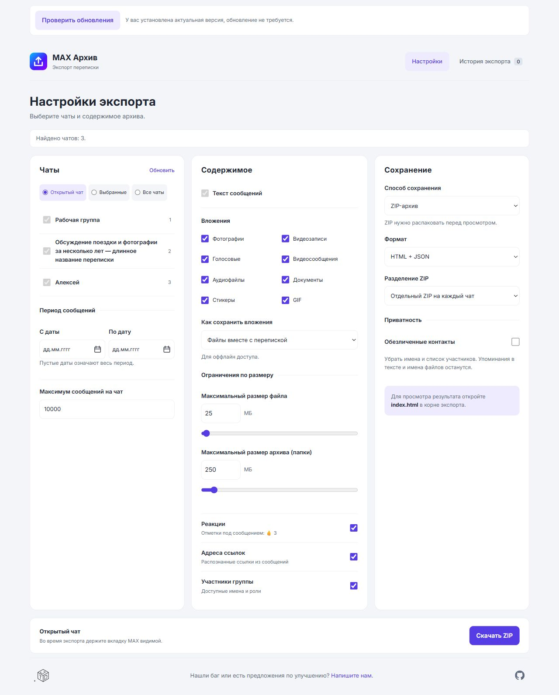

# MAX Архив

Расширение для сохранения переписки из [веб-версии MAX](https://web.max.ru/) на компьютер. Один чат, выбранные переписки или все найденные чаты текущей папки MAX. Сообщения и выбранные типы вложений сохраняются в ZIP или папку в Загрузках.

Проект [Just Trust Digital](https://justtrust.digital). Тестовая версия **0.3.13**. Неофициальное расширение, не связано с разработчиками MAX.

[Скачать расширение](https://github.com/just-trust-digital/max-chat-archive/releases/tag/v0.3.13) · [Сообщить о проблеме](#сообщить-о-проблеме) · [Известные проблемы](KNOWN_ISSUES.md) · [Документация для разработки](docs/development.md)

## Возможности

- Экспорт открытого чата, нескольких выбранных чатов или всех найденных чатов текущей папки MAX.
- На выходе HTML с превью вложений, JSON, CSV и TXT. Отдельные архивы по чатам или один общий ZIP.
- Выбор периода и типов вложений: фото, видео, голосовые, видеосообщения, аудио, стикеры, GIF и документы.
- Список участников для групп с опциональным обезличиванием, даты, пересылки, реакции и ссылки.
- После сбоя можно скачать сохранённую часть экспорта из истории браузера.

## Установка в Chrome

1. Скачайте ZIP из [раздела Releases](https://github.com/just-trust-digital/max-chat-archive/releases) и распакуйте его в постоянную папку.
2. Откройте `chrome://extensions` и включите **Режим разработчика**.
3. Нажмите **Загрузить распакованное расширение** и выберите папку `MaxExport` внутри архива. В ней должен лежать `manifest.json`.
4. Откройте [web.max.ru](https://web.max.ru/) и войдите в аккаунт. Если вкладка уже открыта, обновите её.
5. Нажмите значок пазла в Chrome и выберите **MAX Архив**.

В ZIP есть одностраничная инструкция **START-HERE.pdf**. Папку установленного расширения нельзя удалять или перемещать.

### Обновления

При открытии меню или настроек расширение проверяет публичные релизы GitHub. Если есть новая версия, сверху появляется кнопка **Скачать версию …** без отдельного всплывающего уведомления. Проверяются и тестовые релизы проекта, но только с готовым установочным ZIP. При недоступном GitHub доступна повторная проверка; экспорт продолжает работать.

Кнопка скачивает ZIP в постоянную подпапку **MAX-Archive-updates** текущих Загрузок браузера. Уже скачанные файлы не заменяются. Если в браузере включён запрос места сохранения, он может показать диалог. Автоматически записывать файлы в произвольную папку установки Chrome не разрешает. Дождитесь завершения загрузки, распакуйте содержимое папки `MaxExport` из ZIP поверх установленной папки, нажмите кнопку обновления расширения на `chrome://extensions` и обновите вкладку MAX. Первую версию с этой кнопкой нужно установить вручную.

Посмотреть кнопку на синтетических данных (без реального скачивания):

```powershell
Set-Location D:\DEV\MaxExport
$env:MAX_ARCHIVE_FIXTURE_PORT='8768'
npm run test:browser
```

Откройте http://127.0.0.1:8768/test/popup-preview.html?utm_source=jtd_dev . Остановка — `Ctrl+C`; перезапуск той же командой. Сайт не опубликован.

При установке из исходников выберите корень этого репозитория вместо папки из ZIP. Для Edge страница расширений - `edge://extensions`; отдельная проверка всех функций в Edge не проводилась.

## Экспорт

Для одного чата откройте его в MAX и нажмите **Экспортировать открытый чат** в меню расширения. Сохранение начнётся сразу.

Для выбора переписок, периода, формата и вложений откройте **Настройки и выбор чатов**, задайте параметры и нажмите **Скачать ZIP**. Пустые даты означают весь период; каждый чат сохраняется отдельным архивом.

Поля периода видны сразу; пустые даты означают весь период. В поле **Как сохранить вложения** выберите файлы вместе с перепиской для офлайн-просмотра или только внешние ссылки. Ссылки требуют интернета и могут перестать работать. **Адреса ссылок** и **Реакции** управляют соответствующими метаданными, а не удаляют обычный текст и эмодзи из переписки.

**Во время экспорта держите MAX открытым и видимым.** Не переключайте чаты и не обновляйте страницу. Если появилось предупреждение **Откройте вкладку MAX**, перейдите на неё вручную: обработка продолжится автоматически. Остановить её можно кнопкой **Остановить** на странице экспорта.

Для просмотра результата распакуйте скачанный ZIP и откройте `index.html` в корне экспорта и выберите чат. Оставьте папку `media` рядом с ним. В каждом архиве есть `report.json` с итогами и пропущенными файлами.

### Сохранение в папку без ZIP

В **Настройки и выбор чатов** выберите **Способ сохранения → Папка в Загрузках** и нажмите **Сохранить в папку**. Браузер создаст каталог `max-archive-<дата-время>-<код>` внутри текущего каталога загрузок. Откройте его `index.html`: распаковка не требуется. Внутри будут отдельные папки чатов с перепиской и медиа. Каждый запуск использует новое имя каталога; разбиение ZIP в этом режиме отключено.

Файлы сохраняются через Downloads API последовательно, с подтверждением завершения каждого скачивания. Стартовая страница и отчёт обновляются после обработанных чатов. При ошибке записи очередь останавливается, уже скачанная часть и контрольные точки остаются. Это не автоматическое продолжение после сбоя. Восстановление из истории пока создаёт ZIP с корневым `index.html`.

Место сохранения задаётся настройками загрузок браузера. При включённом запросе места для каждого файла браузер может показывать отдельные диалоги; режим не изменяет эту настройку. Ограничения диска, IndexedDB и доступности вложений остаются. ZIP установочного пакета расширения нужен только для его распространения и не определяет формат экспорта переписки.

## Ограничения

- Расширение читает интерфейс веб-версии. Изменения MAX могут нарушить экспорт. Полнота истории не подтверждается отдельным запросом к серверу; проверяйте результат и отчёт.
- «Все найденные чаты» означает текущую папку MAX. Для другой папки экспорт нужно запустить отдельно.
- Лимиты настраиваются: по умолчанию 25 МБ на файл и 250 МБ на архив или папку. Диапазоны — 1–2000 МБ на файл и 1–4000 МБ на архив/папку. МБ считается как 1024² байт. Недоступные файлы и неподдерживаемые типы остаются в отчёте. Проигрывание медиа зависит от кодеков браузера.
- Экспорт может помечать сообщения прочитанными. Скрытые сообщения, недоступные вложения и скрытые контакты участников не восстанавливаются.
- Сборка ZIP использует оперативную память; в режиме папки файлы скачиваются последовательно и общий ZIP не создаётся. Сохранённая копия позволяет получить уже собранную часть, но не продолжить чтение с места сбоя.

## История экспорта

После сбоя снова откройте настройки расширения в том же профиле браузера. Откройте вкладку **История экспорта** и нажмите **Скачать сохранённое**. Восстановление не требует открытого MAX и не докачивает отсутствующие файлы.

Подписи **Чтение истории**, **Обработка вложений** и **Подготовлено к сохранению** обозначают последний сохранённый этап. Они не подтверждают успешное завершение экспорта. Каждый запуск создаёт отдельную копию.

Копии остаются в браузере до удаления кнопкой **Удалить копию**. Удаление расширения или очистка профиля может удалить их; скачанные ZIP храните отдельно.

## Данные и разрешения

Переписка обрабатывается в браузере, файлы загружаются с доменов MAX и его CDN. Проверка обновлений обращается к публичному GitHub API без учётных данных и содержимого переписок; ZIP скачивается с GitHub только по нажатию кнопки. Список известных проблем загружается из публичного репозитория; при ошибке сети показывается копия из расширения. Расширение не считывает токен аккаунта. Доступ к вкладкам нужен для работы с MAX, к загрузкам — для сохранения файлов, к хранилищу — для настроек и копий экспорта.

Сохранённые копии содержат переписку и файлы в текущем профиле браузера. **Обезличенные контакты** убирает имена отправителей, источники пересылок и список участников. Текст сообщений, упоминания, названия чатов и имена файлов не очищаются; старые копии не изменяются.

## Сообщить о проблеме

В футере меню и настроек нажмите **Нашли баг или есть предложения по улучшению? Напишите нам.** На странице обращения можно выбрать тему и открыть список известных проблем. Опишите ситуацию, проверьте данные обращения и подтвердите отправку. Контакт для ответа необязателен. Кнопка **Отмена** закрывает обращение без отправки. При ошибке сети можно повторить отправку.

Переписка, файлы экспорта, названия чатов, адреса вложений и скриншоты не прикладываются. Отправляются введённый вами текст, контакт, если указан, и данные из раздела «Данные обращения». Обращение поступает в закрытый приёмник Just Trust Digital. Подтверждённый текст доступен владельцу в закрытой карточке GlitchTip; контакт остаётся только в приёмнике. Ничего не отправляется без вашего согласия.

Если удобнее обсуждать подтверждённую проблему публично, используйте [GitHub Issues](https://github.com/just-trust-digital/max-chat-archive/issues) без личных данных и переписки. Краткий [список известных проблем](KNOWN_ISSUES.md) обновляется отдельно.

## Использование с LLM

В пакет включён переносимый скилл [max-archive](skills/max-archive/SKILL.md): запуск экспорта через интерфейс расширения, выбор чатов и периода, разбор локального JSON и проверка пропусков. В распакованном установочном ZIP он находится в `MaxExport/skills/max-archive/`. Можно передать LLM `SKILL.md` вместе с папкой `references` или установить всю папку как скилл своего агента.

Для Codex скопируйте папку `max-archive` в `$env:USERPROFILE\.codex\skills\` (если одноимённого скилла ещё нет), затем откройте новый чат. Пример запроса: **«Используй $max-archive: выгрузи чат “Рабочая группа” за сентябрь 2026, без медиа, и составь список договорённостей. Укажи пропуски истории»**.

Для управления расширением агенту нужен доступ к тому же браузеру/профилю с MAX. Скилл сам не создаёт подключение и не предоставляет учётные данные. Без управления браузером можно передать агенту уже скачанный локальный архив. Обработка реальной переписки зависит от разрешений и среды агента; файлы не нужно публиковать на GitHub.

## Разработка и лицензия

Сборка расширения не требуется. Автоматические тесты запускаются командой `npm test` на Node.js. [Проверки, локальные макеты и сборка пакета](docs/development.md) · [Исследование существующих решений](docs/research-existing.md).

[MIT](LICENSE) · [Just Trust Digital](https://justtrust.digital)

## Интерфейс и локальный просмотр

В расширении используется утверждённый вариант A «Спокойный»: три группы настроек, отдельная вкладка истории, системная светлая или тёмная тема. [Дизайн и токены](docs/design-system.md) · [Предыдущие варианты](docs/design/README.md).

```powershell
Set-Location D:\DEV\MaxExport
$env:MAX_ARCHIVE_FIXTURE_PORT='18769'
npm run test:browser
```

Откройте настройки: http://127.0.0.1:18769/test/export-visibility.html?tab=7&fixture=recovery&theme=light&chats=populated&utm_source=jtd_dev . Форма: http://127.0.0.1:18769/report.html?theme=light&utm_source=jtd_dev . Известные проблемы: http://127.0.0.1:18769/known-issues.html?theme=light&utm_source=jtd_dev . Остановка — `Ctrl+C`; повторный запуск той же командой. Просмотр использует синтетические данные, не подключается к MAX и не отправляет отчёты.




### Ограничения размера

Настройки «Максимальный размер файла» и «Максимальный размер архива (папки)» доступны ползунком и точным числом. Значения сохраняются в браузере и записываются в `report.json`. Для отдельных ZIP лимит действует на каждый ZIP, для общего ZIP и папки — на все выбранные чаты вместе. Размер ZIP включает служебные записи и текст; размер папки — суммарный размер файлов, без учёта места файловой системы. Обновление собственного index.html/отчёта не считается дважды.

Вложения, которые не помещаются, пропускаются с причиной в отчёте. Если не помещается сама переписка или отчёт, экспорт завершается ошибкой: увеличьте лимит и повторите запуск. Сохранённая копия остаётся в истории. Восстановление ранее сохранённой копии создаёт ZIP из имеющихся данных без новых ограничений; старые копии не обрезаются. Большие ZIP требуют соответствующего объёма оперативной памяти.


Календарь в настройках всегда на русском языке, с понедельника, независимо от языка браузера. Даты показаны как ДД.ММ.ГГГГ; кнопка «Без ограничения» очищает соответствующую границу. Можно выбрать месяц и год, управлять днями стрелками, Home/End и PageUp/PageDown. Escape закрывает календарь. Текст сообщений включён всегда: неактивный чекбокс показывает пояснение при наведении и клавиатурном фокусе.
